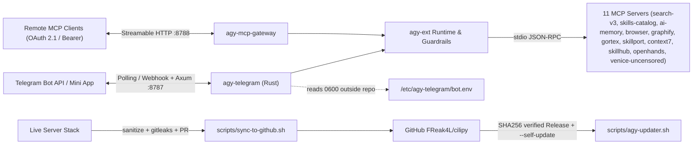

# Architecture Overview

`cilipy` combines a high-throughput Rust Telegram bridge (`agy-telegram`), an isolated Remote MCP Gateway (`agy-mcp-gateway`), modular AI agent rules & skills, external stdio MCP servers, and a GitOps release/update pipeline.

## System Topology

## Crate Breakdown (`bot/crates/`)

| Crate | Purpose |
|---|---|
| `agy-core` | Config validation, 3-tier ACL, account rotation & 1% weekly reserve, proxy pool, secret scanner, atomic file store |
| `agy-render` | GFM-to-Telegram HTML/Rich renderer, UTF-16 entity splitting, premium emoji overlay |
| `agy-net` | Resilient Telegram HTTP client, FloodWait queue, proxy circuit breaker, `sd_notify` watchdog |
| `agy-ext` | Multi-engine runtime, OpenHands tools, SkillHub & skill indexer, fleet updater, update seal guard |
| `agy-widgets` | Compressed interactive Telegram widgets (`<= 4096 B` zlib-9), HMAC `initData` WebApp bridge |
| `agy-mcp-gateway` | Loopback `:8788` Streamable HTTP MCP gateway with OAuth 2.1 PKCE, manifest pinning, and HITL gates |
| `agy-bot` | Main binary (`agy-telegram`), Telegram handlers, webhook/poller router, cron scheduler, CLI self-updater |
